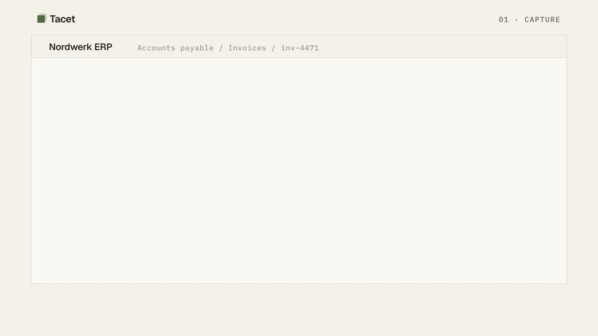
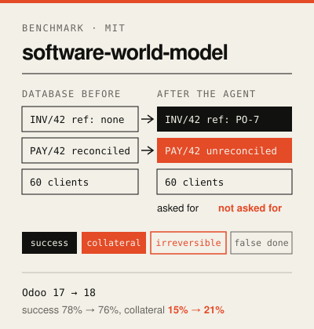
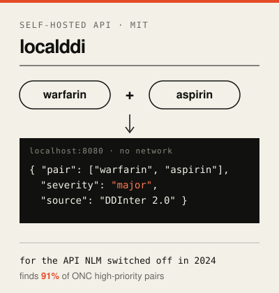
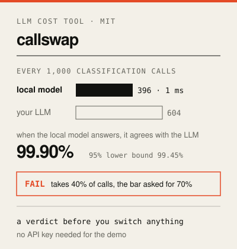

  

  
  
  
  
  
  

Building <b>Tacet</b> full time in San Francisco &#183; MS Business Analytics &amp; AI, Johns Hopkins (Dean's Scholarship, 2026) English &#183; 日本語 &#183; नेपाली &#183; हिन्दी

---

## Now: Tacet

  

Every team has someone whose judgment never made it into the SOP: which vendor double-bills, which equipment counts as capex. Tacet learns those rules by watching that person work. When it guesses their next decision wrong, it waits for a pause and asks one question. The answer becomes a rule in their own words, tested on cases they never showed, then served to AI agents over API and MCP and used to stop a new hire's wrong save.

<a href="https://core-production-332c.up.railway.app">See it live →</a> · <a href="https://core-production-332c.up.railway.app/app">Try the demo →</a> · The code is private; <a href="mailto:shubhamjoshipro.mail@gmail.com?subject=Tacet">email me</a> for a walkthrough.

<b>How Tacet works, and how it was built</b>
 

- **A model can't just claim a rule was learned.** The engine is plain Python with Bayesian thresholds, and language models only translate. Sealed tests commit their predictions with a SHA-256 hash before any human labels the cases. A rule doesn't compile unless it quotes the expert verbatim and reproduces their past decisions.
- **It works on a real ledger today.** When screen capture failed on a real accounting app, I rebuilt the first release around the CSV export bookkeepers already have. On the sample ledger, one answered question took held-back accuracy from 96% to 100% across 44 transactions.
- **It started as a hackathon prototype.** I built it at HackNation × ElevenLabs on Oct 3, 2026, then turned it into a multi-tenant product in nine days: 234 commits, 481 tests, ten real-browser journeys against live models, key auth, per-organisation data separation, personal-data scrubbing and a daily spend cap.

<i>Python · FastAPI · numpy · Postgres · React · TypeScript · Chrome MV3 · ElevenLabs agents · MCP · Playwright · Railway</i>

---

## Open source

Tools anyone can install and run, each with a demo that needs no account and an evaluation that includes the results that didn't go well. Click a card to open the repo.

<table>
<tr>
<td width="33%" valign="top">

**Did the agent break something?** AI agents use real business apps (Odoo, Dolibarr, Invoice Ninja), and afterwards the whole database is compared, so a run that "succeeded" but undid a customer's payment gets caught.

<a href="https://github.com/shubhamjoshipromail-svg/software-world-model">Repo</a> · <a href="https://github.com/shubhamjoshipromail-svg/software-world-model/blob/main/reports/phase0_writeup.md">Write-up</a> · <a href="https://github.com/shubhamjoshipromail-svg/software-world-model#quickstart">Run it</a>
</td>
<td width="33%" valign="top">

**A drug interaction checker you host.** The US government's free interaction API shut down in 2024 and left health software without data. localddi answers the same requests from a database on your own machine.

<a href="https://github.com/shubhamjoshipromail-svg/localddi">Repo</a> · <a href="https://github.com/shubhamjoshipromail-svg/localddi/blob/main/docs/evaluation.md">Evaluation</a> · <a href="https://github.com/shubhamjoshipromail-svg/localddi#try-it-in-one-minute">Try it</a>
</td>
<td width="33%" valign="top">

**Stop paying an LLM for easy questions.** Trains a small local model on the answers your LLM already gave, then tests how often they agree before you switch. Unsure calls still go to the LLM.

<a href="https://github.com/shubhamjoshipromail-svg/callswap">Repo</a> · <a href="https://github.com/shubhamjoshipromail-svg/callswap#results">Results</a> · <a href="https://github.com/shubhamjoshipromail-svg/callswap#60-second-demo">Try it</a>
</td>
</tr>
</table>

---

## Selected builds

<table>
<tr>
<td width="50%" valign="top">

### AgentDock
**Agents that act on real accounts, behind rules the prompt can't change.**

Multi-step agent flows run real MCP tools behind deny-by-default policy, approval gates and budget caps. An agent can draft your email; sending always waits for a human.

225 commits · 66 test files · crash-safe Postgres job queue

<a href="https://www.youtube.com/watch?v=NdwP83VBurU">Walkthrough →</a> · <a href="https://github.com/shubhamjoshipromail-svg/AgentDock">Source →</a>

</td>
<td width="50%" valign="top">

### Vibe Curator
**Generated media that stays editable.**

Images, video, shaders and music from four providers land in one persistent scene instead of a flattened file. Model-written GLSL must pass a static guard and a real compile before it renders.

Beta 2 live · web, Chrome new tab, macOS wallpaper

<a href="https://vibe-curator-production.up.railway.app">Try it →</a> · <a href="https://www.youtube.com/watch?v=EHCwmSFjtA8">Demo →</a> · <a href="https://github.com/shubhamjoshipromail-svg/vibe-curator">Source →</a>

</td>
</tr>
<tr>
<td width="50%" valign="top">

### OpsPilot
**The fix was the labels, not a bigger model.**

A support-ticket router. ModernBERT stalled at 52.3% on ten overlapping classes; regrouping them into seven real queues took it to 74.0% on the locked test set. At 0.80 confidence it auto-routes 62.5% of tickets at 85.0% accuracy.

<a href="https://huggingface.co/shubhamjoshipro/opspilot-routing-modernbert-base-clean-v1">Model →</a> · <a href="https://github.com/shubhamjoshipromail-svg/opspilot-ai">Source →</a>

</td>
<td width="50%" valign="top">

### ACHP × CMS
**A policy question nobody had measured, answered for the client.**

Four CMS sources reconciled into a 138,263 × 208 dataset, with a 12× enrollment overcount caught before it reached a model. ACHP held the stronger cost position in 493 of 875 counties. Presented to the client's leadership.

<a href="https://portfolio-production-9040.up.railway.app/#achp">Case study →</a>

</td>
</tr>
</table>

<b>More projects</b> (hackathons, experiments, coursework)
 

| Project | What it is |
|---|---|
| [RxCheck](https://pharmacy-production-f226.up.railway.app) · [source](https://github.com/shubhamjoshipromail-svg/rxcheck) | Pharmacist-facing interaction review over 152,416 records; the prototype localddi came from |
| [Negotiator](https://github.com/shubhamjoshipromail-svg/hacknation_bluejays) | Voice agent that negotiates inside explicit deal limits |
| [FridgeChef](https://fride-project-production.up.railway.app) | Fridge and receipt photos into inventory and streamed recipes |
| [Nimbus](https://nimbus-web-production.up.railway.app) | Burnout companion with nine grounded tools, built in 14 hours |
| [Team Tools](https://github.com/shubhamjoshipromail-svg/team-tools) | Small tools for repetitive coordination work, including [Batch Draft Review](https://batch-draft-review-production.up.railway.app/) |
| [jev-market-radar](https://github.com/shubhamjoshipromail-svg/jev-market-radar) | Breaking news checked against prediction-market resolution rules |
| [bank-marketing-ml](https://github.com/shubhamjoshipromail-svg/bank-marketing-ml) | Term-deposit propensity model, 7th of 59, ROC-AUC 0.8285 |
| [property-automl-hackathon](https://github.com/shubhamjoshipromail-svg/property-automl-hackathon) | Property-price regression, 19th place |
| [dating-agent-rl](https://github.com/shubhamjoshipromail-svg/dating-agent-rl) | Tabular Q-learning and SARSA with an LLM as the classifier |
| [questforge-ai](https://github.com/shubhamjoshipromail-svg/questforge-ai) | Phaser 4 game experiment, unfinished |

---

## How I build

1. **Code decides; models explain.** Tacet's thresholds, RxCheck's detection and AgentDock's permissions are plain code. The model writes the words around them.
2. **Prove it on cases you didn't see.** A Tacet rule counts once it holds on sealed cases. OpsPilot reports the locked test set, not the best validation run.
3. **Check the data before reaching for a bigger model.** OpsPilot's biggest gain came from fixing the labels. In Tacet, the plan changed when screen capture failed on a real app.
4. **Consequential actions wait for a person.** No AgentDock grant lets an outbound send fire on its own.
5. **Say where the work stops.** Every project here names its limits.

---

<b>Tools, and where they're used</b>
 

| Layer | Tools | Where |
|

---|---|
| Learning systems | Bayesian updating, value-of-information question planning, sealed held-out tests | Tacet |
| Agents | MCP servers and clients, tool calling, approvals, guardrails, evals | Tacet, [AgentDock](https://github.com/shubhamjoshipromail-svg/AgentDock), [rxcheck](https://github.com/shubhamjoshipromail-svg/rxcheck) |
| Voice | ElevenLabs agents, custom LLM endpoint, turn-taking | Tacet, [Negotiator](https://github.com/shubhamjoshipromail-svg/hacknation_bluejays) |
| Modeling | PyTorch, ModernBERT fine-tuning, calibration, H2O AutoML, SHAP | [opspilot-ai](https://github.com/shubhamjoshipromail-svg/opspilot-ai), [bank-marketing-ml](https://github.com/shubhamjoshipromail-svg/bank-marketing-ml) |
| Generative | multi-provider orchestration, guarded codegen, WebGL/GLSL | [vibe-curator](https://github.com/shubhamjoshipromail-svg/vibe-curator) |
| Product | Python, FastAPI, TypeScript, React, Next.js, Chrome extensions | every live link above |
| Data and delivery | SQL/Postgres, Alembic, Prisma, Docker, GitHub Actions, Railway | Tacet, the CMS pipeline, RxCheck's 152K-record import |

---

<b>Tacet: how a question gets chosen</b>
 
The planner scores each candidate question by its expected value of information against the cost of interrupting, and it only speaks at a natural pause. An answer is compiled into a rule in a small DSL. The compile gate rejects the rule unless its quote appears verbatim in the transcript and it reproduces the expert's earlier decisions. A vague answer once produced "Home Depot → Equipment" for every purchase; replaying the rule against history caught it. Each change writes a learning receipt: the prediction before and after, the expert's quote, and the parameter that moved. In a live hackathon run, a taught threshold of 3,600 moved to 4,069 after two counterexamples, and the sealed test went from 9/11 to 11/11.

<b>AgentDock: durable execution and policy</b>
 
Postgres-backed job queue with lease and heartbeat crash recovery, idempotent external actions, step-cursor resume, SSE run events and per-user concurrency caps. Grants clamp from read_only to draft_only, approval_required or blocked, with a memory firewall and an MCP kill switch. A red-team suite shows that prompt injection arriving through tool output cannot trigger an unapproved send.

<b>OpsPilot: the full numbers</b>
 
TF-IDF with logistic regression 44.1%; ModernBERT on the original ten classes 52.3%. Seven routing families on about 24k leakage-safe examples: 73.1% validation (reproducible from <code>trainer_state.json</code> in the model repo), 74.0% on the locked test set, weighted-F1 0.721, macro-F1 0.576, ECE 0.080. Part of the jump comes from the seven-class problem being easier, which is the honest way to report it. Unstable DeBERTa runs were left out rather than reported.

<b>ACHP × CMS: the analysis</b>
 
Premiums were about $2.8 higher and maximum out-of-pocket about $97 higher (p &lt; 0.001). 67.5% of national plans eroded drug benefits, against 41.3% of ACHP plans. The work was delivered as Tableau dashboards and a market-trends deck for the client.

---

## Off the keyboard

I co-founded <b>BAAIO</b>, the applied AI student organization at Johns Hopkins Carey, and grew it past 100 members with workshops and a buildathon. Before that I ran a small web and marketing studio in Japan, taught adult professionals, and once tested fifty ice cream recipes in a bedroom freezer. I've lived in Japan, Australia and the US.

<i>Know a team whose best operator is the only one who knows the rules? <a href="mailto:shubhamjoshipro.mail@gmail.com?subject=Tacet%20pilot">I'd like to meet them.</a></i>

