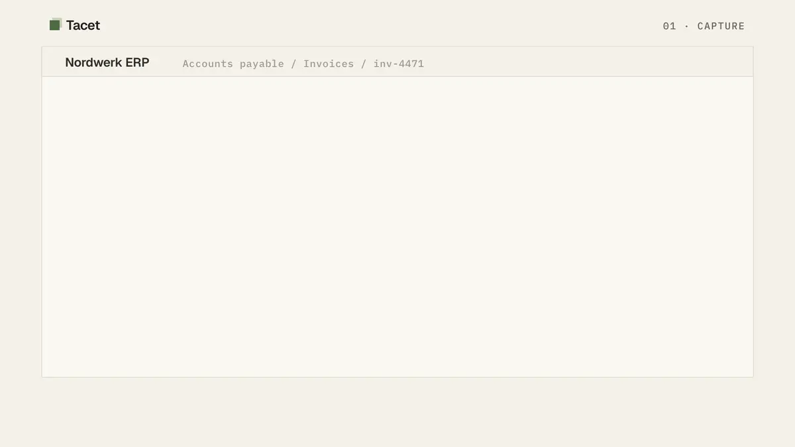

  

  
  
  
  
  
  

Building <b>Tacet</b> full time in San Francisco &#183; MS Business Analytics &amp; AI, Johns Hopkins (Dean's Scholarship, 2026) English &#183; 日本語 &#183; नेपाली &#183; हिन्दी

---

## Now: Tacet

  

Every team has someone whose judgment never made it into the SOP. They know which vendor double-bills and which equipment counts as capex. AI agents and new hires follow the written process, so they get those calls wrong.

Tacet learns those rules by watching the expert work. Before each decision it writes down what it expects them to do. When it guesses wrong, it waits for a pause and asks one question. The answer becomes a rule in the expert's own words. The rule is tested on cases the expert never showed, then served to agents over API and MCP and used to stop a new hire's wrong save, quoting the expert's sentence.

- **A model can't just claim a rule was learned.** The engine is plain Python with Bayesian thresholds, and language models only translate. Sealed tests commit their predictions with a SHA-256 hash before any human labels the cases. A rule doesn't compile unless it quotes the expert verbatim and reproduces their past decisions.
- **It works on a real ledger today.** When screen capture failed on a real accounting app, I rebuilt the first release around the CSV export bookkeepers already have. On the sample ledger, one answered question took held-back accuracy from 96% to 100% across 44 transactions.
- **It started as a hackathon prototype.** I built it at HackNation × ElevenLabs on Oct 3, 2026, then turned it into a multi-tenant product in nine days: 234 commits, 481 tests, ten real-browser journeys against live models, key auth, per-organisation data separation, personal-data scrubbing and a daily spend cap.

<i>Python · FastAPI · numpy · Postgres · React · TypeScript · Chrome MV3 · ElevenLabs agents · MCP · Playwright · Railway</i>

<a href="https://core-production-332c.up.railway.app">See it live →</a> · <a href="https://core-production-332c.up.railway.app/app">Try the demo →</a> · The code is private; I'm happy to walk you through it: <a href="mailto:shubhamjoshipro.mail@gmail.com?subject=Tacet">email me</a>.

---

## Before Tacet

<table>
<tr>
<td width="50%" valign="top">

### AgentDock
**Agents that act on real accounts, behind rules the prompt can't change.**

Multi-step agent flows run real MCP tools behind deny-by-default policy, approval gates and budget caps. Permissions are resolved on the server, so prompt text can ask for a capability but never grant one. An agent can draft your email; sending always waits for a human.

225 commits · 66 test files · Postgres job queue with crash recovery and idempotent actions

<a href="https://www.youtube.com/watch?v=NdwP83VBurU">Walkthrough →</a> · <a href="https://github.com/shubhamjoshipromail-svg/AgentDock">Source →</a>

</td>
<td width="50%" valign="top">

### Vibe Curator
**Generated media that stays editable.**

Images, video, shaders and music from four providers land in one persistent scene, instead of ending as a flattened file. Model-written GLSL must clear a static guard and a real compile before it renders, so a bad generation can't hang the GPU.

Beta 2 live · web, Chrome new tab, macOS wallpaper · OpenAI, Anthropic, Veo, Lyria

<a href="https://vibe-curator-production.up.railway.app">Try it →</a> · <a href="https://www.youtube.com/watch?v=EHCwmSFjtA8">Demo →</a> · <a href="https://github.com/shubhamjoshipromail-svg/vibe-curator">Source →</a>

</td>
</tr>
<tr>
<td width="50%" valign="top">

### OpsPilot
**The fix was the labels, not a bigger model.**

A support-ticket router. ModernBERT stalled at 52.3% on ten overlapping classes. Regrouping them into seven real queues took it to 73.1% validation and 74.0% on the locked test set (95% CI 72.6–75.4). At 0.80 confidence it auto-routes 62.5% of tickets at 85.0% accuracy and hands the rest to a person.

Calibrated (ECE 0.080) · macro-F1 0.576, still weak on small queues

<a href="https://huggingface.co/shubhamjoshipro/opspilot-routing-modernbert-base-clean-v1">Model →</a> · <a href="https://github.com/shubhamjoshipromail-svg/opspilot-ai">Source →</a>

</td>
<td width="50%" valign="top">

### RxCheck
**The database decides; the model only explains.**

Drug-interaction review over 152,416 records. Detection is deterministic, and core checking still runs when every outside service is down: 26 of 26 failure scenarios pass. The research report gives the unflattering results equal billing.

RxNorm normalization · override audit trail · a research prototype, and labelled as one

<a href="https://pharmacy-production-f226.up.railway.app">Live demo →</a> · <a href="https://github.com/shubhamjoshipromail-svg/rxcheck">Source →</a>

</td>
</tr>
<tr>
<td width="50%" valign="top">

### ACHP × CMS
**A policy question nobody had measured, answered for the client.**

Four CMS sources reconciled into a 138,263 × 208 dataset, with a 12× enrollment overcount caught before it reached a model. OLS with HC3 errors measured the cost shift, and ACHP held the stronger cost position in 493 of 875 counties. Top-three team school-wide; presented to the client's leadership.

<a href="https://portfolio-production-9040.up.railway.app/#achp">Case study →</a>

</td>
<td width="50%" valign="top">

### Smaller builds

[Negotiator](https://github.com/shubhamjoshipromail-svg/hacknation_bluejays), a voice agent that negotiates inside explicit deal limits. 
[FridgeChef](https://fride-project-production.up.railway.app), fridge and receipt photos into inventory and streamed recipes. 
[Nimbus](https://nimbus-web-production.up.railway.app), a burnout companion with nine grounded tools, built in 14 hours. 
[Team Tools](https://github.com/shubhamjoshipromail-svg/team-tools), small tools for repetitive coordination work, including [Batch Draft Review](https://batch-draft-review-production.up.railway.app/). 
[bank-marketing-ml](https://github.com/shubhamjoshipromail-svg/bank-marketing-ml), 7th of 59, ROC-AUC 0.8285.

</td>
</tr>
</table>

---

## How I build

1. **Code decides; models explain.** Tacet's thresholds, RxCheck's detection and AgentDock's permissions are plain code. The model writes the words around them.
2. **Prove it on cases you didn't see.** A Tacet rule counts once it holds on sealed cases. OpsPilot reports the locked test set, not the best validation run.
3. **Check the data before reaching for a bigger model.** OpsPilot's biggest gain came from fixing the labels. In Tacet, the plan changed when screen capture failed on a real app.
4. **Consequential actions wait for a person.** No AgentDock grant lets an outbound send fire on its own.
5. **Say where the work stops.** Every project here names its limits.

---

## Tools, and where they're used

| Layer | Tools | Where |
|---|---|---|
| Learning systems | Bayesian updating, value-of-information question planning, sealed held-out tests | Tacet |
| Agents | MCP servers and clients, tool calling, approvals, guardrails, evals | Tacet, [AgentDock](https://github.com/shubhamjoshipromail-svg/AgentDock), [rxcheck](https://github.com/shubhamjoshipromail-svg/rxcheck) |
| Voice | ElevenLabs agents, custom LLM endpoint, turn-taking | Tacet, [Negotiator](https://github.com/shubhamjoshipromail-svg/hacknation_bluejays) |
| Modeling | PyTorch, ModernBERT fine-tuning, calibration, H2O AutoML, SHAP | [opspilot-ai](https://github.com/shubhamjoshipromail-svg/opspilot-ai), [bank-marketing-ml](https://github.com/shubhamjoshipromail-svg/bank-marketing-ml) |
| Generative | multi-provider orchestration, guarded codegen, WebGL/GLSL | [vibe-curator](https://github.com/shubhamjoshipromail-svg/vibe-curator) |
| Product | Python, FastAPI, TypeScript, React, Next.js, Chrome extensions | every live link above |
| Data and delivery | SQL/Postgres, Alembic, Prisma, Docker, GitHub Actions, Railway | Tacet, the CMS pipeline, RxCheck's 152K-record import |

---

## More detail

<b>Tacet: how a question gets chosen</b>
 
The planner scores each candidate question by its expected value of information against the cost of interrupting, and it only speaks at a natural pause. An answer is compiled into a rule in a small DSL. The compile gate rejects the rule unless its quote appears verbatim in the transcript and it reproduces the expert's earlier decisions. A vague answer once produced "Home Depot → Equipment" for every purchase; replaying the rule against history caught it. Each change writes a learning receipt: the prediction before and after, the expert's quote, and the parameter that moved. In a live hackathon run, a taught threshold of 3,600 moved to 4,069 after two counterexamples, and the sealed test went from 9/11 to 11/11.

<b>AgentDock: durable execution and policy</b>
 
Postgres-backed job queue with lease and heartbeat crash recovery, idempotent external actions, step-cursor resume, SSE run events and per-user concurrency caps. Grants clamp from read_only to draft_only, approval_required or blocked, with a memory firewall and an MCP kill switch. A red-team suite shows that prompt injection arriving through tool output cannot trigger an unapproved send.

<b>OpsPilot: the full numbers</b>
 
TF-IDF with logistic regression 44.1%; ModernBERT on the original ten classes 52.3%. Seven routing families on about 24k leakage-safe examples: 73.1% validation (reproducible from <code>trainer_state.json</code> in the model repo), 74.0% on the locked test set, weighted-F1 0.721, macro-F1 0.576, ECE 0.080. Part of the jump comes from the seven-class problem being easier, which is the honest way to report it. Unstable DeBERTa runs were left out rather than reported.

<b>ACHP × CMS: the analysis</b>
 
Premiums were about $2.8 higher and maximum out-of-pocket about $97 higher (p &lt; 0.001). 67.5% of national plans eroded drug benefits, against 41.3% of ACHP plans. The work was delivered as Tableau dashboards and a market-trends deck for the client.

---

## Off the keyboard

I co-founded <b>BAAIO</b>, the applied AI student organization at Johns Hopkins Carey, and grew it past 100 members with workshops and a buildathon. Before that I ran a small web and marketing studio in Japan, taught adult professionals, and once tested fifty ice cream recipes in a bedroom freezer. I've lived in Japan, Australia and the US.

<i>Know a team whose best operator is the only one who knows the rules? <a href="mailto:shubhamjoshipro.mail@gmail.com?subject=Tacet%20pilot">I'd like to meet them.</a></i>

